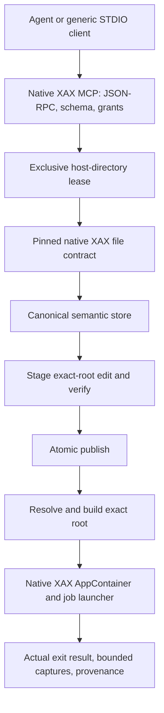

# Architecture — native Windows preview

The dependency direction is `XAX-MCP -> XAX`. Application semantic stores, protocol, schemas, confinement program,
installation and host examples live here. The compiler repository publishes a host-independent native CLI seed and
canonical compiler/hash programs. Ordinary XAX users install no MCP dependency.

The server and launcher are canonical `.xax` programs compiled into Windows executables. MCP/JSON and typed edit
records carry requests but never replace semantic source. Upstream native edit/verify/resolve/build enforce XAX
semantics; this repository contains no independent compiler or verifier. Exact-root transactions preserve unchanged
semantic object identities and native verification gates publication.

Host environment and CLI flags define authority. Compiler/work/seed paths cannot be supplied by tools. Native process
calls use fixed argument vectors, with no shell. A non-inheritable OS lease excludes simultaneous servers from one
work directory. Private directories remain a host prerequisite, and this is not a general multi-tenant service.

The native launcher creates a capability-less AppContainer and constrained job. A verified program alone does not
authorize execution. Only a host grant enables it. See [security boundaries](SECURITY.md),
[current source/build](NATIVE.md), and [unimplemented gates](WINDOWS_READINESS.md).
